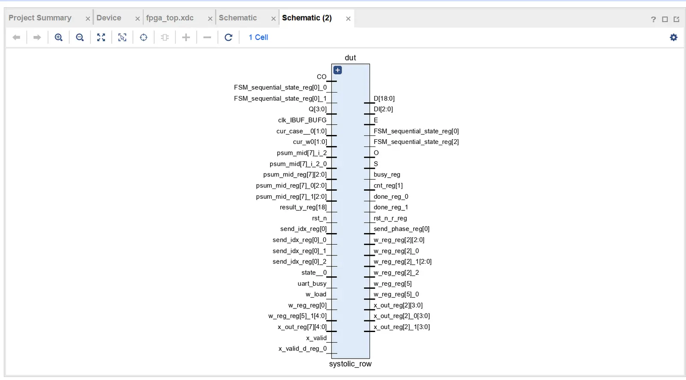
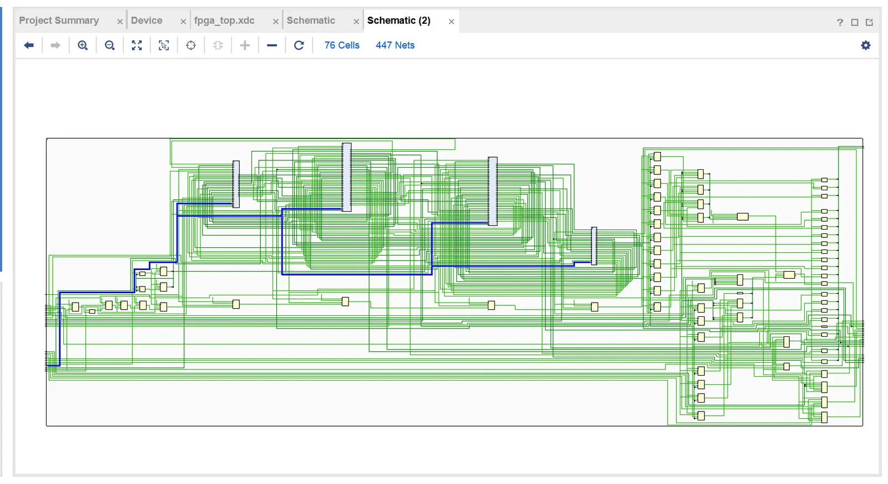
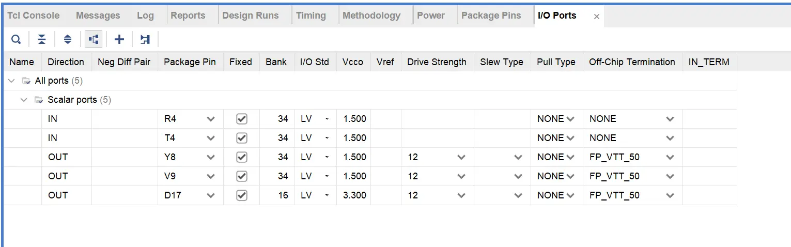
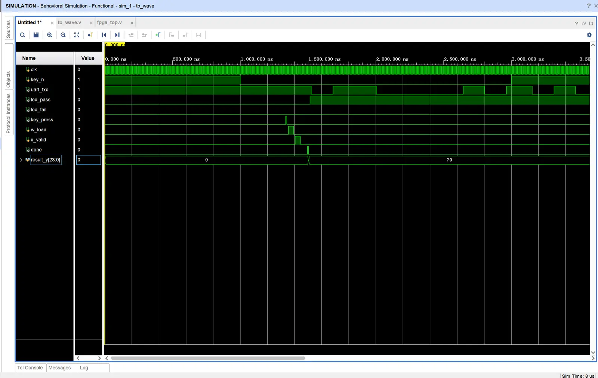
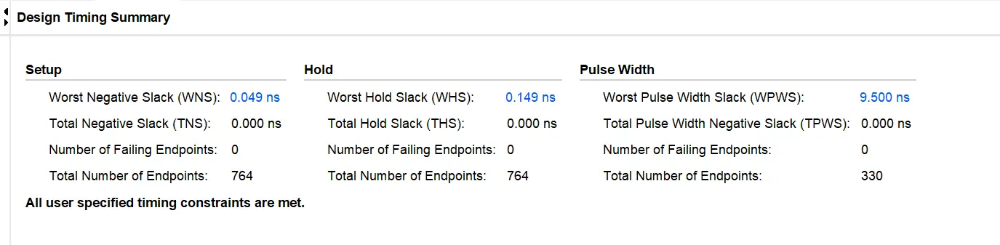
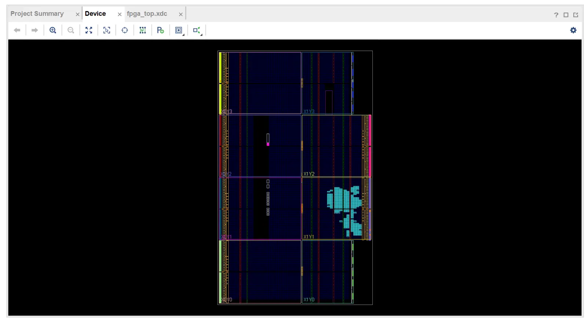
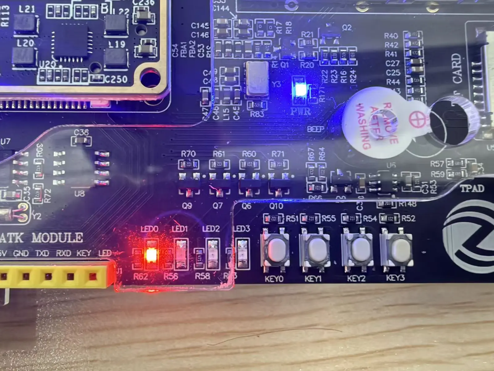

## 1. 问题与背景

大一开学两个月，我做了一个最小规模的硬件实践：1×4脉动阵列乘加单元。架构借鉴的是教科书里的经典脉动阵列（1978年由H. T. Kung提出，也是TPU和NPU的核心思路），我拿它的最小教学规模练手，和Claude Code协作从零走了一遍实现。直接铺2D大阵列容易把数据流问题和布线拥塞搅在一起，所以先做1×4这一行，把权重预载-x流入-部分和传递整条链路跑通，再考虑扩规模。

整件事分两步推进：2026-11-08先在本地用开源工具走通前端（定规格-写Verilog-Python金标准对拍-自检testbench-Yosys通用综合），随后补上FPGA板级封装、时序收敛和上板实测。上板前我先定了三条验收线：4组预置用例全对、Vivado实现时序收敛（Setup WNS>=0）、上板实测串口报文全过。这篇只记1×4这一行；2×2的数字IC后端全流程发在另一篇里，4×4目前停在规格定版，文末再交代边界。

实验和上板环境固定如下：
* **开发板**：正点原子达芬奇Pro开发板（底板+CF7A100B核心板，XC7A100T-FGG484-2），借自田伟龙学长
* **EDA与仿真工具**：Yosys（前期通用综合）；Vivado 2020.2；Verilator自检台架（`tb_fpga_top.v`+`sim_main.cpp`）和Vivado XSim（`tb_wave.v`，2026-11-23补做波形）
* **上板时间地点**：2026-11-14，RM工作室

---

## 2. 核心原理：两条数据链怎么对上拍

1×4脉动阵列的算式很直接：

$$y = W \cdot x = \sum_{i=0}^{3} w_i x_i$$

数据流采用weight-stationary策略：4个权重$w_0 \sim w_3$先逐个装进4个PE里固定不动，输入向量$x_0 \sim x_3$再逐拍从左往右流过阵列。

整行能按自然顺序连续喂数，核心在于`mac_pe`内部两条数据链的速度差：
* **x传递链**：每个PE只放1级寄存器，每拍向前推进1个PE。
* **部分和传递链**：每个PE放2级寄存器（`psum_mid`和`psum_out`），每2拍才向前推进1个PE，移动速度刚好是x链的一半。

正因为部分和在每个PE里多停1拍，$x_0$进PE0算出的部分和传到PE1时，刚好碰上晚1拍出发、走得更快的$x_1$。这样输入端就能直接按$x_0, x_1, x_2, x_3$的顺序连续送进去，不用在外部额外插错位延迟寄存器。

时序节拍上，把采样到$x_0$的那一拍记为第0拍，整行延迟固定为$\text{LAT}=2N=8$（$N=4$）。第8拍时`done`拉高1拍并同步更新`y_out`，随后`done`回落，`y_out`保持当前结果，直到下一次`done`到来。



---

## 3. 三层架构与上板封装

整个工程拆成三层模块，从内核到板级外壳逐层包起来：
1. **`mac_pe`**：单个乘加处理单元，位宽定为`DATA_W=8`、`ACC_W=24`、无符号运算，内部包含x单级寄存和部分和两级流水。
2. **`systolic_row`**：例化$N=4$个`mac_pe`串成一行，按$w_0 \sim w_3$顺序逐拍装载权重，并输出`done`和`y_out`。
3. **`fpga_top`**：FPGA上板外壳。

开发板上没有现成的总线接口，只有按键、LED和串口可用，所以我包了一层`fpga_top`把控制和观测全接出来：
* **按键消抖**：50MHz时钟下计数1,000,000个周期（20ms），滤掉机械抖动后产生单拍`key_press`。
* **用例状态机**：每按一次键切到下一组预置测试向量，自动完成权重装载、激活输入和结果锁存。
* **串口报文与LED判读**：按115200波特率（分频系数434）往外发`CASEn: Y=值 EXP=期望 PASS/FAIL`字符串，同时拉高`led_pass`或`led_fail`给出硬件直读结果。

### 关键代码片段

`rtl/mac_pe.v`里的部分和两级流水（`psum_mid`和`psum_out`）是整套节拍对齐的关键，核心寄存逻辑如下：

```verilog
wire [2*DATA_W-1:0] prod = x_in * w_reg;

// x forwarding and two-stage multiply-accumulate, updated every edge
always @(posedge clk or negedge rst_n) begin
    if (!rst_n) begin
        x_out    <= {DATA_W{1'b0}};
        psum_mid <= {ACC_W{1'b0}};
        psum_out <= {ACC_W{1'b0}};
    end else begin
        x_out    <= x_in;
        psum_mid <= psum_in + prod;
        psum_out <= psum_mid;
    end
end
```

`fpga_top.v`里内置了4组预置激励和期望值常数表，和仿真金标准文件`golden_cases.vh`逐位一致：

```verilog
localparam [127:0] CASE_W = {
    8'd1, 8'd1, 8'd1, 8'd1,                     // case3
    8'd3, 8'd7, 8'd0, 8'd10,                    // case2
    8'd255, 8'd255, 8'd255, 8'd255,             // case1
    8'd4, 8'd3, 8'd2, 8'd1                      // case0
};
localparam [127:0] CASE_X = {
    8'd1, 8'd1, 8'd1, 8'd1,                     // case3
    8'd1, 8'd4, 8'd9, 8'd2,                     // case2
    8'd255, 8'd255, 8'd255, 8'd255,             // case1
    8'd8, 8'd7, 8'd6, 8'd5                      // case0
};
localparam [95:0] CASE_Y = {
    24'd4,                                      // case3
    24'd51,                                     // case2
    24'd260100,                                 // case1
    24'd70                                      // case0
};
```

### 关键参数与引脚分配

#### 表1 关键设计参数（板上实测口径vs仿真缩放口径）

| 参数 | 板上值 | 仿真值 | 说明 |
|---|---|---|---|
| 系统时钟 | 50MHz（周期20ns，clk=R4） | 台架10ns周期 | 约束create_clock 20ns |
| 串口分频CLKS_PER_BIT | 434（≈115200波特率） | 16 | 源码默认值434 |
| 消抖DEBOUNCE_CYCLES | 1,000,000（20ms） | 32 | 源码默认值 |
| 数据位宽DATA_W/累加位宽ACC_W | 8/24 | 同 | 无符号乘加 |
| 流水延迟LAT | 8拍（x0采样→done） | 同 | 2N，N=4 |

#### 表2 顶层引脚分配（核对自Vivado I/O Ports报告）

| 信号 | 脚 | 方向 | 电平 | Bank |
|---|---|---|---|---|
| clk | R4 | IN | LVCMOS15（1.5V） | 34 |
| key_n | T4 | IN | LVCMOS15（1.5V） | 34 |
| led_fail | Y8 | OUT | LVCMOS15（1.5V） | 34 |
| led_pass | V9 | OUT | LVCMOS15（1.5V） | 34 |
| uart_txd | D17 | OUT | LVCMOS33（3.3V） | 16 |





---

## 4. 数据与验证：仿真、时序收敛与上板

### 4.1 前端开源验证与板级仿真（Yosys+Verilator+XSim）

在包FPGA外壳之前，2026-11-08我先在本地把核心模块（`systolic_row`+`mac_pe`）的前端流程跑通：用Python写金标准模型独立对拍，自检testbench跑4个定向用例（含满量程）全过；随后用Yosys做通用综合，得到1859个单元、227个触发器，无锁存器、无组合环、无警告，触发器数和RTL寄存器位宽逐位对得上。

加上`fpga_top`外壳后，板级测试向量同样覆盖常规递增、8位全满幅（255）、含零权重和全1共4组边界情况。

#### 表3 四组预置用例（源码fpga_top.v常数表，与golden_cases.vh逐位一致）

| 用例 | W（w0..w3） | X（x0..x3） | 期望Y | 验算 |
|---|---|---|---|---|
| case0 | 4,3,2,1 | 8,7,6,5 | 70 | 32+21+12+5 |
| case1 | 255,255,255,255 | 255,255,255,255 | 260100 | 4×255×255（满幅） |
| case2 | 3,7,0,10 | 1,4,9,2 | 51 | 3+28+0+20（含权重为0） |
| case3 | 1,1,1,1 | 1,1,1,1 | 4 | 全1 |

Verilator自检台架对串口输出做逐字符比对，`eda-fpga-prep/sim_result.log`输出原文如下：
> `TB RESULT: ALL PASS (4/4 cases, exact string match)`
> 四行报文依次为`CASE0: Y=70 EXP=70 PASS`、`CASE1: Y=260100 EXP=260100 PASS`、`CASE2: Y=51 EXP=51 PASS`、`CASE3: Y=4 EXP=4 PASS`。

2026-11-23我用Vivado XSim（`tb_wave.v`）补跑了case0完整波形，时间轴从左到右逐段对得上：1.0µs处按键拉低触发→约1.32µs消抖结束产生`key_press`→`w_load`依次装载4个权重→`x_valid`拉高连续送入$x_0 \sim x_3$→约1.46µs处`done`拉高1拍、`result_y`跳变到70、`led_pass`拉起→随后`uart_txd`逐帧发出串口报文。


*(注：该波形图于2026-11-23在缩放仿真参数下截取，CLKS_PER_BIT=16、DEBOUNCE_CYCLES=32、台架时钟周期10ns。)*

### 4.2 时序收敛：先看路径延迟构成，再切实现策略

2026-11-13第一次跑完Vivado默认实现，时序没过：Setup WNS=-0.158ns、Setup TNS=-0.538ns，764条检查终点里有5条违例。

遇到违例我没急着动RTL，先拆开最差路径看延迟构成。违例最重的一条路径从`result_y_reg`到`uart_data_reg`，总延迟20.035ns：
* **逻辑延迟**：6.549ns
* **连线延迟**：13.486ns
* **扇出数量**：25

连线延迟占了整条路径的67%以上。说到底，问题出在24位结果寄存器`result_y_reg`直接挂了25个负载、扇出偏高，布局布线时把线拉长了，和组合逻辑深度无关。

既然根因在布线和扇出，我先选改动代价最低的做法：不动一行RTL，2026-11-14直接把Vivado实现策略换成`Performance_ExplorePostRoutePhysOpt`，重新跑布局布线和物理优化。重跑之后Setup WNS从-0.158ns拉正到+0.049ns，违例终点清零。

#### 表4 时序收敛前后对比（Vivado 2020.2，impl_1，Route Design最终报告）

| 指标 | 重跑前（2026-11-13） | 重跑后（2026-11-14） |
|---|---|---|
| Setup WNS | -0.158ns | +0.049ns |
| Setup TNS | -0.538ns | 0.000ns |
| Setup违例终点 | 5/764 | 0/764 |
| Hold WHS | +0.149ns | +0.149ns |
| Hold违例终点 | 0/764 | 0/764 |
| Pulse Width WPWS | — | 9.500ns（违例0/330） |
| 结论行 | 未收敛 | All user specified timing constraints are met |



打开Device布局视图可以看到，整个1×4设计在XC7A100T芯片上只占右下角一小块逻辑资源，布线空间很充裕，所以换成物理优化策略后，工具很快就把扇出和绕线压进了20ns时钟周期内。



### 4.3 上板实测

2026-11-14我在RM工作室连板烧录比特流。中间卡过一次下载器：Vivado自带的Digilent Adept运行库和Win11不兼容，板子一直连不上，层层排查到驱动层才定位原因，升级运行库后解决。

烧录通了以后，上电连续按动板载按键触发4组用例，串口助手收到的4条报文和表3期望值逐字对上，实测4/4全过。



---

## 5. 踩坑、边界与后续

* **时序违例先看构成再动手**：看到负裕量就盲目插流水线，容易白改RTL还把原来的节拍对齐弄乱。这次拆出6.549ns逻辑、13.486ns连线和扇出25之后，直接靠`Performance_ExplorePostRoutePhysOpt`物理优化拉正时序，没改一行代码就过了。
* **下载器驱动别只查线缆**：Vivado在Win11上连不上板子，未必是板卡或线的问题，这次就是Vivado自带的旧版Digilent Adept运行库和系统不兼容，升级运行库才打通。
* **仿真参数必须按比例缩放**：板上消抖要等1,000,000个时钟周期（20ms）、串口分频434，真按原参数跑XSim，波形得拉几十毫秒、信号全挤成一条线。仿真时把消抖缩到32周期、分频缩到16，台架时钟用的是10ns而不是板上的20ns，看图读时间必须按台架口径折算。
* **三套规模数字口径不能混用**：2026-11-08用Yosys对核心模块（`systolic_row`+`mac_pe`）做的通用综合结果（1859单元/227触发器）没有做工艺库映射、时序分析和布局布线；Vivado顶层原理图显示的76 Cells/447 Nets是顶层视图节点计数；两者都不等于XC7A100T最终布局布线后的切片资源占用。
* **流程与阵列边界**：这篇走到FPGA实现和上板为止，不包含ASIC流程里的DRC/LVS签核（2×2那篇才是全开源ASIC后端口径）；4×4阵列目前只完成规格定版，还没进RTL和上板验证。
* **现场证据缺口坦白**：可惜的是，2026-11-14上板当天我只拍了板卡和笔记本工程画面，烧录成功弹窗、板载LED亮灯瞬间和串口助手4行输出截图当时没单独存下来，这里直接坦白，不补造截图。

说到底，这个1×4教学级阵列离真正的工业级IC还差得远，但作为能跑通的最小一步，它帮我把从RTL、仿真、时序收敛到FPGA上板的整条链路摸了一遍。后续我又顺着这条线用全开源工具链+SKY130工艺库跑通了2×2后端（详见另一篇实录），摸清硬件生态的边界之后，接下来的主线会切到工具链开源、反馈更快的AI Infra和CUDA算子优化上——继续把学到的写下来，把做过的摆出来。

---

## 6. 参考来源

* **正点原子达芬奇Pro官方例程**：引脚分配参考`10_flow_led`、`19_uart_loopback`和按键例程，逐脚核对清单见仓库`eda-fpga-prep/PART_AND_PINS.md`。
* **项目代码与仿真日志**：[github.com/lingquan11/systolic-mac-1x4](https://github.com/lingquan11/systolic-mac-1x4)（公开仓库，含`rtl/mac_pe.v`、`rtl/systolic_row.v`、`fpga_top.v`、`tb_fpga_top.v`、`sim_result.log`）。
